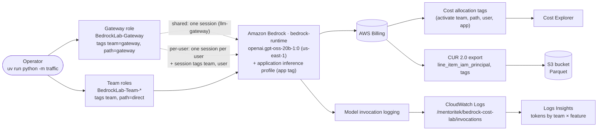

# Bedrock Cost Attribution Lab

**Split Amazon Bedrock spend by team, application and prompt — a reproducible AWS lab.**

> **Sample data notice.** Every team, user, prompt and dollar figure in this repository is fictional sample data made for this lab. Nothing here comes from any client or real workload.

## What it shows

Amazon Bedrock gives you three separate attribution layers. Each one answers a different question:

| Layer | Question it answers | In this lab |
|---|---|---|
| **IAM principal attribution** (cost allocation tags on IAM roles and session tags) | *Which team or user spent it?* | One role per team tagged `team=<team>`, plus a shared "gateway" role used two ways: one shared session vs one session per user with session tags |
| **Application inference profiles** (a tagged profile in front of the model) | *Which application spent it?* | One profile, `bedrock-lab-support-assistant`, tagged `app=support-assistant` |
| **Request metadata + model invocation logs** | *Which feature or prompt spent it?* | Every call carries `requestMetadata` (team, feature, run, mode, user); CloudWatch Logs Insights totals tokens per team × feature |

**None of these is retroactive.** Cost allocation tags only apply to usage after you activate them, and the CUR 2.0 IAM-principal columns only fill in for usage after the export option is on. The lab is built so you can see that for yourself (tests T5 and T6).

## Architecture



Two CDK stacks deploy it:

- **`BedrockCostLab`** (day 0): team roles, gateway role, application inference profile, invocation log group and logging role, the model invocation logging setting (an `AwsCustomResource`, because CloudFormation has no resource type for it), the CUR 2.0 bucket, and a $25 monthly budget alert.
- **`BedrockCostLabCurExport`** (day 1): the CUR 2.0 export with IAM principal data. It's a separate stack on purpose. Some traffic has to exist *before* the export does, so test T6 can check what the export shows for that earlier usage.

Every name, tag, team, weight, model, price and email lives in [`config/lab.config.json`](config/lab.config.json). The CDK app and the Python tools both read that file. **Put your own email and prices in `config/lab.config.local.json`**, a copy of that file that git ignores. When the local file exists, every tool reads it instead of `lab.config.json`, so your details never end up in a commit. Remove a team from it and its role, its traffic and its rows disappear everywhere.

## Prerequisites

- **A standalone AWS account on the Paid plan.**
  - *Standalone*, because cost allocation tags are managed at the payer account level, so a member account of an AWS Organization can't activate them. `scripts/preflight.py` checks this and stops on a member account.
  - *Paid plan*, because a Free-plan account is upgraded automatically if it joins an Organization, and its Free Tier credits then expire. The Paid plan also has every service and feature an enterprise account has.
- **Region `us-east-1`.** The Data Exports bucket policy names `arn:aws:bcm-data-exports:us-east-1:…`, and gpt-oss-20b is offered in-Region in us-east-1.
- **AWS CLI v2** with a profile that can administer the account. `requirements.txt` includes the botocore CRT extra, so profiles that sign in with `aws login` work; other credential types need nothing extra.
- **Node.js LTS** (see [`.nvmrc`](.nvmrc); `nvm use`) and npm.
- **[uv](https://docs.astral.sh/uv/)** to manage Python. Follow the official [uv installation guide](https://docs.astral.sh/uv/getting-started/installation/). uv provides Python 3.12+ itself, so you don't need a separate Python install. Every Python command in this README runs through `uv run`.
- **Bedrock access to `openai.gpt-oss-20b-1:0`.** If `uv run python -m traffic smoke` returns `AccessDeniedException`, open the model's page in the Bedrock console's model catalog / model access page and accept its terms, then retry.
- **Invocation logging must be free.** Bedrock model invocation logging is one setting per account and Region. This lab owns it while deployed, and `preflight.py` refuses to continue if something else already configured it.

## Cost

These are small numbers. On the default volume the bill is cents per team, so the *shares* between teams carry the story.

| What | Why it costs anything | Expect |
|---|---|---|
| Bedrock tokens | About 2,500 calls in total (4 runs × 600 calls, plus smoke and T3), each about 300 input and up to 256 output tokens | well under $1 at gpt-oss-20b rates. Check the current us-east-1 price on the [Bedrock pricing page](https://aws.amazon.com/bedrock/pricing/) |
| CloudWatch Logs | A few MB of invocation logs | cents at most |
| CUR 2.0 bucket | Data Exports writes a few small Parquet files; standard S3 storage rates apply | cents |
| Lambda | A handful of custom-resource invocations at deploy and destroy | negligible |
| Cost Explorer API | Each `verify.py` Cost Explorer request may be billed per request | cents if you run it a few dozen times |

**Likely total: under $2.** The stack also creates a **$25 monthly budget** that emails you at 80% of actual spend and at 100% of forecast spend. Volume is one setting (`traffic.callsPerRun`), and cost scales linearly with it.

**Tear it down when you're done** (see [Teardown](#teardown)).

## Steps

Pick your recording or review date first. **Day 0 must be at least 3 days before it**, because tags and cost data each take up to 24 hours to show up.

```bash
# once
cd cdk && npm ci && cd ..
uv venv --python 3.12
uv pip install -r requirements.txt
cp config/lab.config.json config/lab.config.local.json   # then put your email and prices in the local file
```

Two things you'll see during `npm ci`, both expected:
- **Skipped install scripts.** npm blocks dependency install scripts by default. [`cdk/package.json`](cdk/package.json) records an explicit `allowScripts` denial for each package that has one: `esbuild`, `@swc/core`, `@parcel/watcher`, `fsevents` and `unrs-resolver`. All of them ship prebuilt binaries, and their scripts are only build or verify fallbacks that the CDK app and tests don't need ([npm install-scripts](https://docs.npmjs.com/cli/v11/commands/npm-install-scripts)).
- **`npm audit` warnings.** They come from the dev tooling (the jest test runner's dependency tree), not from `aws-cdk-lib` or `constructs`. `npm audit --omit=dev` reports none. Don't run `npm audit fix --force`: it would replace the pinned versions, for example by downgrading jest to 25.0.0, and break the tests.

| When | Step | Command | Test |
|---|---|---|---|
| Day 0 | Set `budget.email` (and optionally `pricing`) in `config/lab.config.local.json` | edit the file | — |
| Day 0 | Preflight: account type, logging free, boto3 new enough | `uv run python scripts/preflight.py` | T0 |
| Day 0 | Bootstrap CDK, deploy the main stack | `cd cdk && npx cdk bootstrap && npx cdk deploy BedrockCostLab` | T0 |
| Day 0 | Smoke test + log check | `uv run python -m traffic smoke` then `uv run python scripts/verify.py t0` | T0 |
| Day 0 | **Traffic before tag activation and before the export exists** | `uv run python -m traffic run --mode direct --run-id day0-pre` | T5, T6 |
| Day 1 (a few hours to 24 h later) | Activate cost allocation tags (re-run until all keys are listed) | `uv run python scripts/activate_tags.py` | T1, T5 |
| Day 1 | Create the CUR 2.0 export, now that usage exists | `cd cdk && npx cdk deploy BedrockCostLabCurExport` | T6 |
| Day 1 (after activation) | Post-activation traffic | `uv run python -m traffic run --mode direct --run-id day1-direct` | T1, T4 |
| Day 1 | Gateway, one shared session | `uv run python -m traffic run --mode gateway-shared --run-id day1-gw-shared` | T2 |
| Day 1 | Gateway, one session per user | `uv run python -m traffic run --mode gateway-per-user --run-id day1-gw-peruser` | T2 |
| Day 1 | Chat Completions check | `uv run python -m traffic check-chat-completions` | T3 |
| Day 2 | Read results | `uv run python scripts/verify.py t1` … `t6` | T1–T6 |
| After | Tear down | see [Teardown](#teardown) | — |

Why the waits:
- Tags appear in Billing only after the principal has made at least one Bedrock call.
- Tags and cost data can each take up to 24 hours.
- Cost allocation tags don't apply to earlier usage.
- The export refreshes up to three times a day.

Useful flags:
- Every command takes `--profile <name>` and `--config <path>`.
- `--show-ids` turns off account-ID masking. By default, all console output replaces any 12-digit number with `************` so recordings don't show your account ID.
- `uv run python -m traffic run --mode direct --dry-run` prints the call plan without touching AWS. The plan is deterministic: the same config and seed always give the same plan.
- Config file order, first match wins:
  1. `--config <path>` (Python) or `-c configPath=<path>` (CDK)
  2. the `LAB_CONFIG` environment variable
  3. `config/lab.config.local.json`, if it exists
  4. `config/lab.config.json`
- For `cdk synth`/`deploy` you can also pass `-c budgetEmail=you@example.com` instead of editing a file.

**If CloudFormation rejects the export.** CloudFormation documents the export's `TableConfigurations` as "Object of String", while the Data Exports API uses a map keyed by table name, which is what the stack sends. If `cdk deploy BedrockCostLabCurExport` fails on that property, create the identical export with the API instead:

```bash
uv run python scripts/create_export_cli.py create
```

At teardown, use `uv run python scripts/create_export_cli.py delete` in place of destroying that stack.

## Reading the results

Each `verify.py` subcommand prints a table and writes `results/<test>.json`. It reports what AWS shows and never decides a verdict.

- **T0 — `verify.py t0`.** Shows:
  - the account type from preflight
  - the status of both stacks
  - whether invocation logging is configured
  - for every smoke-test request ID, whether a matching CloudWatch log event arrived within 15 minutes

  Console: CloudWatch → Log groups → `/mentoritek/bedrock-cost-lab/invocations`.
- **T1 — `verify.py t1`.** Cost Explorer daily Bedrock cost grouped by the `team` tag (the key exactly as Billing lists it, recorded by `activate_tags.py`), the first date each team appears, and hours since activation. Console: Cost Explorer → Group by → Tag → `team`.
- **T2 — `verify.py t2 [--day YYYY-MM-DD]`.**
  - Cost Explorer grouped by `team`, filtered to `path=gateway`.
  - CUR 2.0 Bedrock rows grouped by `line_item_iam_principal` and the `iamPrincipal/` tags. The shared-session calls and the per-user calls should land on different principals and tags. Whatever billing shows is what gets recorded.
- **T3 — `verify.py t3`.**
  - Cost Explorer grouped by the `app` tag.
  - CUR rows whose resource ID is the inference profile ARN.
  - The two HTTP status codes from `check-chat-completions`: the foundation model as `model` (the control) vs the profile ARN. The AWS docs disagree about the second one, which is why the lab tests it.
- **T4 — `verify.py t4 [--day …]`.**
  - Runs the Logs Insights token query for one UTC day.
  - Multiplies the tokens by the prices you entered in `config.pricing`. It refuses to run while they're `null`.
  - Compares that estimate with the Cost Explorer Bedrock total for the same day, as a difference in $ and %.
- **T5 — `verify.py t5 [--day …]`.**
  - Cost Explorer for the pre-activation day grouped by `team`, printing the raw group keys, including the no-tag group.
  - CUR hourly rows before vs after the activation timestamp.
- **T6 — `verify.py t6`.** Three timestamps side by side:
  - the first lab call in `runs/`
  - when the export was created
  - the earliest CUR row that has `line_item_iam_principal`

  This is an open question; the lab makes no prediction.

The two Logs Insights queries are in [`queries/logs-insights/`](queries/README.md) if you'd rather paste them into the console.

## What this does not do / limits

- **Per-prompt dollars are estimates.** The lab multiplies tokens by list prices. Discounts, commitments, batch pricing and Free Tier aren't modeled.
- **Request metadata isn't enforced.** It's whatever the caller sends. The bill doesn't know about it; only the invocation logs do.
- **Application inference profiles are model-specific.** Per the AWS docs, the Responses and Chat Completions APIs reject them (400). T3 checks this because another AWS page lists Chat Completions as supported.
- **Invocation logging is one setting per account and Region.** While this lab is deployed, it owns that setting. The logs include prompt and response text, which is why every prompt here is synthetic.
- **Caller identity reaches the bill only with the IAM-principal option, and only in CUR 2.0** (`INCLUDE_IAM_PRINCIPAL_DATA`, which adds `line_item_iam_principal`). Legacy CUR doesn't have it.
- **Editing the inference profile's name, description or model source replaces it** (new ARN), per the CloudFormation reference.
- **Two things the docs leave open, recorded by the run rather than assumed:**
  - how Billing lists IAM-principal tag keys (with or without a prefix)
  - whether the gateway role's own `path` tag still applies to sessions that carry session tags

## Teardown

```bash
cd cdk
npx cdk destroy BedrockCostLabCurExport
npx cdk destroy BedrockCostLab
cd .. && uv run python scripts/teardown_check.py            # add --deactivate-tags to set the tag keys back to Inactive
```

`teardown_check.py` confirms each of these is gone and reports anything left:
- the invocation logging setting
- the export
- the bucket
- the inference profile
- the log group
- the budget
- both stacks

What stays behind:

- **The CDK bootstrap stack `CDKToolkit`** and its staging bucket (`cdk-hnb659fds-assets-<account>-us-east-1`), unless you remove them. To remove them, delete the `CDKToolkit` stack in the CloudFormation console. If the deletion fails because the staging bucket still holds objects, empty that bucket in the S3 console and delete the stack again.
- **Activated cost allocation tag keys**, unless you pass `--deactivate-tags`.
- **Cost Explorer history** of the lab's spend, which stays after the resources are gone.

## Repository layout

```
├── config/lab.config.json        every name, tag, team, weight, model, price, email
├── cdk/                          CDK app (TypeScript)
│   ├── bin/app.ts                both stacks in us-east-1
│   ├── lib/config.ts             loads + validates the config
│   ├── lib/attribution-lab-stack.ts
│   ├── lib/cur-export-stack.ts
│   └── test/stacks.test.ts       assertions (npx jest)
├── traffic/                      uv run python -m traffic run | smoke | check-chat-completions
├── scripts/                      preflight, activate_tags, verify (t0–t6), teardown_check, create_export_cli
├── queries/logs-insights/        tokens-by-team-feature, tokens-by-principal
├── tests/                        pytest (offline; no AWS calls)
├── runs/                         local run logs (git-ignored)
└── results/                      verify output (git-ignored)
```

Developer checks (no AWS calls):

```bash
cd cdk && npm ci && npx tsc --noEmit && CDK_DEFAULT_ACCOUNT=111111111111 npx cdk synth -c budgetEmail=lab-owner@example.com && npx jest
cd .. && uv pip install -r requirements-dev.txt && uv run ruff check . && uv run pytest
```

## Sources for publication

AWS announcements and guides:
- [Amazon Bedrock now supports cost allocation by IAM user and role (AWS What's New, 9 Apr 2026)](https://aws.amazon.com/about-aws/whats-new/2026/04/bedrock-iam-cost-allocation)
- [Introducing granular cost attribution for Amazon Bedrock (AWS Machine Learning Blog, 17 Apr 2026)](https://aws.amazon.com/blogs/machine-learning/introducing-granular-cost-attribution-for-amazon-bedrock/)
- [Track usage and costs in Amazon Bedrock](https://docs.aws.amazon.com/bedrock/latest/userguide/cost-management.html)
- [IAM principal attribution](https://docs.aws.amazon.com/bedrock/latest/userguide/cost-mgmt-iam-principal-tracking.html)
- [Application inference profiles (cost tracking)](https://docs.aws.amazon.com/bedrock/latest/userguide/cost-mgmt-application-inference-profiles.html)
- [Per-request metadata tagging](https://docs.aws.amazon.com/bedrock/latest/userguide/cost-mgmt-request-metadata.html)
- [Cost attribution FAQ](https://docs.aws.amazon.com/bedrock/latest/userguide/cost-mgmt-faq.html)
- [Inference profiles](https://docs.aws.amazon.com/bedrock/latest/userguide/inference-profiles.html), [Prerequisites for inference profiles](https://docs.aws.amazon.com/bedrock/latest/userguide/inference-profiles-prereq.html) and [Create an application inference profile](https://docs.aws.amazon.com/bedrock/latest/userguide/inference-profiles-create.html)
- [Endpoints supported by Amazon Bedrock](https://docs.aws.amazon.com/bedrock/latest/userguide/endpoints.html)
- [Monitor model invocation using CloudWatch Logs and Amazon S3](https://docs.aws.amazon.com/bedrock/latest/userguide/model-invocation-logging.html)
- [PutModelInvocationLoggingConfiguration (API reference)](https://docs.aws.amazon.com/bedrock/latest/APIReference/API_PutModelInvocationLoggingConfiguration.html)
- [Configure model invocation logging by using AWS CloudFormation (Prescriptive Guidance)](https://docs.aws.amazon.com/prescriptive-guidance/latest/patterns/configure-bedrock-invocation-logging-cloudformation.html)
- [Converse (API reference)](https://docs.aws.amazon.com/bedrock/latest/APIReference/API_runtime_Converse.html)
- [Chat Completions API (Amazon Bedrock)](https://docs.aws.amazon.com/bedrock/latest/userguide/inference-chat-completions.html)
- [gpt-oss-20b model card](https://docs.aws.amazon.com/bedrock/latest/userguide/model-card-openai-gpt-oss-20b.html) and [Nova Micro model card](https://docs.aws.amazon.com/bedrock/latest/userguide/model-card-amazon-nova-micro.html)

CloudFormation and CDK:
- [Amazon Bedrock resource types (CloudFormation)](https://docs.aws.amazon.com/AWSCloudFormation/latest/TemplateReference/AWS_Bedrock.html)
- [AWS::Bedrock::ApplicationInferenceProfile](https://docs.aws.amazon.com/AWSCloudFormation/latest/TemplateReference/aws-resource-bedrock-applicationinferenceprofile.html) and [CDK CfnApplicationInferenceProfile](https://docs.aws.amazon.com/cdk/api/v2/docs/aws-cdk-lib.aws_bedrock.CfnApplicationInferenceProfile.html)
- [AWS CDK: ApplicationInferenceProfile (alpha)](https://docs.aws.amazon.com/cdk/api/v2/docs/@aws-cdk_aws-bedrock-alpha.ApplicationInferenceProfile.html) (not used here; the lab uses the L1 construct)
- [CDK AwsCustomResource](https://docs.aws.amazon.com/cdk/api/v2/docs/aws-cdk-lib.custom_resources.AwsCustomResource.html)
- [AWS::BCMDataExports::Export](https://docs.aws.amazon.com/AWSCloudFormation/latest/TemplateReference/aws-resource-bcmdataexports-export.html) and [CDK CfnExport](https://docs.aws.amazon.com/cdk/api/v2/docs/aws-cdk-lib.aws_bcmdataexports.CfnExport.html)
- [AWS::Budgets::Budget](https://docs.aws.amazon.com/AWSCloudFormation/latest/TemplateReference/aws-resource-budgets-budget.html)
- [Node.js versions supported by the AWS CDK](https://docs.aws.amazon.com/cdk/v2/guide/node-versions.html)

Billing and Data Exports:
- [Cost and Usage Report (CUR) 2.0 table dictionary](https://docs.aws.amazon.com/cur/latest/userguide/table-dictionary-cur2.html)
- [Setting up an Amazon S3 bucket for data exports](https://docs.aws.amazon.com/cur/latest/userguide/dataexports-s3-bucket.html)
- [Creating a standard export](https://docs.aws.amazon.com/cur/latest/userguide/dataexports-create-standard.html) and [Data query](https://docs.aws.amazon.com/cur/latest/userguide/dataexports-data-query.html)
- [UpdateCostAllocationTagsStatus](https://docs.aws.amazon.com/aws-cost-management/latest/APIReference/API_UpdateCostAllocationTagsStatus.html) and [ListCostAllocationTags](https://docs.aws.amazon.com/aws-cost-management/latest/APIReference/API_ListCostAllocationTags.html)
- [Choosing an AWS Free Tier plan](https://docs.aws.amazon.com/awsaccountbilling/latest/aboutv2/free-tier-plans.html) and [AWS Free Tier FAQs](https://aws.amazon.com/free/faqs/)

Pricing:
- [Amazon Bedrock pricing](https://aws.amazon.com/bedrock/pricing/)
- [Amazon CloudWatch pricing](https://aws.amazon.com/cloudwatch/pricing/)

## About

Built for the Mentoritek video *Your Bedrock Bill Tripled — Find Out Which Team Did It*.

- Video: [VIDEO_URL]
- Step-by-step guide: [GUIDE_URL]

Questions or work enquiries: [mentoritek.com](https://mentoritek.com).

## License

[MIT](LICENSE) © 2026 Mentoritek
